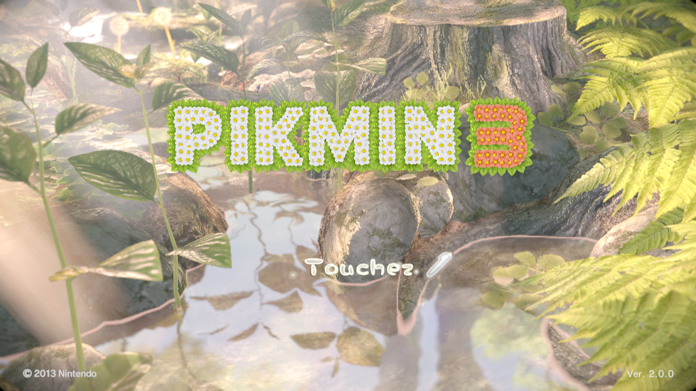
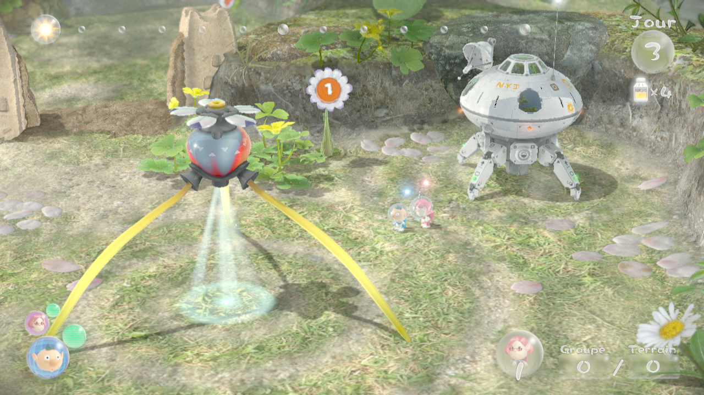
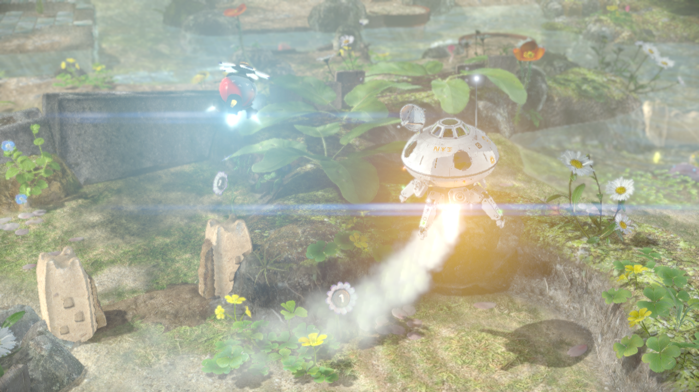
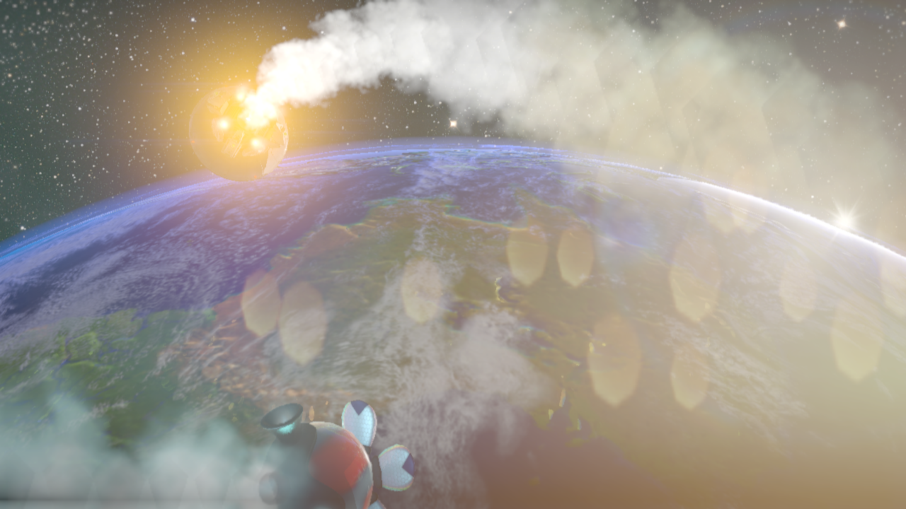
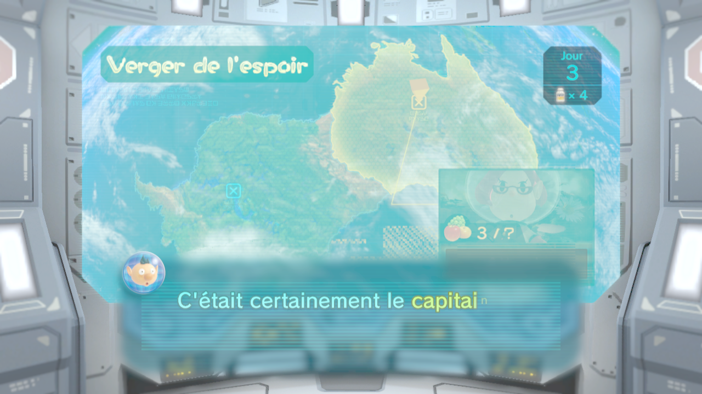
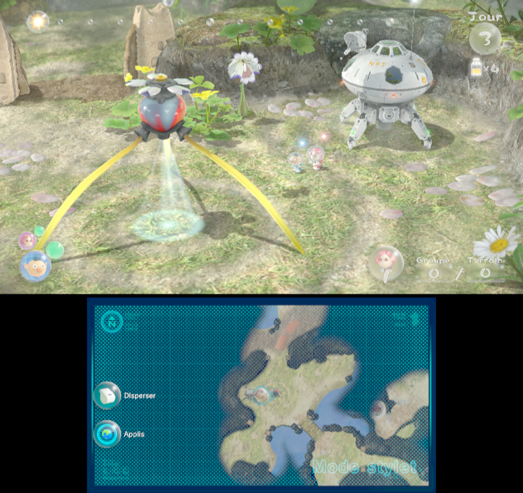

# Pikmin 3: native Windows port (static recompilation)

A native Windows (x86-64, Vulkan) build of **Pikmin 3** for the Wii U, made by **statically
recompiling** the game's PowerPC code into C++, together with a reimplementation of the Wii U
system libraries it needs. No emulator runs in the background: the game code itself is compiled
for your PC.

| | |
|---|---|
|  |  |
|  |  |



> **Legal notice.** This repository contains **no game files** and **no Nintendo code**: no
> game data, no executable, no recompiled code. You need **your own decrypted dump** of the game
> and its update, made from a console you own. `setup.bat` builds everything locally from that
> dump. Do not share the files it produces (`decompile/extracted`, `decompile/recomp/generated`,
> `pikmin3.exe`, ...): they are derived from the game.

## Status

The game is playable from the beginning: 3D rendering, both screens (TV and GamePad), sound,
touch screen (mouse), keyboard and controller input, saving. It has not been played through to
the end yet - bug reports are welcome.

Known issues:
- **cutscene videos are skipped** (no H.264 decoder yet);
- the menu shaders are rebuilt by hand when the dump's copy is damaged, so menus can look slightly off in that case;
- some sound effects are not filtered (voice low-pass / biquad filters), and the GamePad speaker is not played;
- a few small rendering differences (text colour of the first dialog, dotted pattern on the GamePad screen).

## Requirements

- **Windows 10 or 11, 64-bit**, and a GPU with **Vulkan 1.1** support.
- **Visual Studio 2022** (the free Community edition is fine) with the
  **Desktop development with C++** workload, plus these individual components:
  **C++ Clang tools for Windows** and **C++ CMake tools for Windows**.
  (Instead of the Clang component you can install [LLVM](https://github.com/llvm/llvm-project/releases).)
- **[Vulkan SDK](https://vulkan.lunarg.com/sdk/home#windows)** (default options).
- **[Python](https://www.python.org/downloads/) 3.9 or newer** - tick *Add python.exe to PATH* during installation.
- **[Git](https://git-scm.com/download/win)**.
- About **15 GB of free disk space** (game dump not included) and some patience: the first build
  compiles several hundred thousand lines of generated code.

## Your game dump

You need a **decrypted** dump of:

| Content | Title ID | Required |
|---|---|---|
| Pikmin 3 (base game) | `000500001012BE00` | yes |
| Pikmin 3 update **v96** | `0005000E1012BE00` | yes |
| Pikmin 3 DLC | `0005000C1012BE00` | optional |

Only the **European** version with **update v96** is supported for now: the recompilation is
tied to that exact executable (`setup.bat` checks it). Other regions would need their own
function list.

Each one is a folder with `code`, `content` and `meta` subfolders (for example made with
*Dumpling* on your Wii U). Name the folders so that they contain **`[Game]`**, **`[Update]`**
and **`[DLC]`**, and put them in the same folder, for example:

```
D:\Games\Pikmin 3\
    PIKMIN 3 [Game] [000500001012be00]\
    PIKMIN 3 [Update] [0005000e1012be00]\
    PIKMIN 3 [DLC] [0005000c1012be00]\      (optional)
```

The simplest is to put them **next to the repository folder** (or inside it): then they are
found automatically.

## Setup

1. Install the requirements above.
2. Download this repository - with Git:
   ```bat
   git clone https://github.com/CrOwOleyy/pikmin3debloat.git
   ```
   (or *Code → Download ZIP* on GitHub, then extract it; Git is still needed by the setup).
3. Open the repository folder and **double-click `setup.bat`** - or, from a terminal, if your
   dump is elsewhere:
   ```bat
   setup.bat -GameDir "D:\Games\Pikmin 3"
   ```

`setup.bat` then:
1. checks the required tools and tells you what is missing;
2. finds your dump;
3. downloads the third-party tools (decaf-emu, XenonRecomp, Vulkan-Headers, as git submodules)
   and applies this project's patches to them;
4. extracts the game code from the update (`code/carrot.rpx`) and prepares it;
5. builds the recompiler and turns the game code into C++ (a few minutes);
6. builds `pikmin3.exe` (the long part: count from 20 minutes to an hour, depending on your CPU);
7. rebuilds the menu shader file if your dump's copy is damaged.

If something fails, fix what the message says and run `setup.bat` again: finished steps are
skipped. Run it again too after updating the repository (`git pull`).

## Playing

Double-click **`play.bat`** (it starts `decompile\recomp\build\pikmin3.exe --split`). The window
shows the TV screen on top and the GamePad screen below; the **mouse is the GamePad touch
screen**. Saves go to `decompile\recomp\build\save`.

### Controls

| Wii U GamePad | Keyboard | Xbox / XInput controller |
|---|---|---|
| Left stick | W A S D (Z Q S D on AZERTY) | left stick |
| Right stick | I J K L | right stick |
| A / B / X / Y | Space / Left Shift / E / Q (A on AZERTY) | B / A / Y / X (Nintendo layout) |
| L / R | 1 / 3 | LB / RB |
| ZL / ZR | Left Ctrl / C | LT / RT |
| + / − | Enter / Backspace | Start / Back |
| D-pad | arrow keys | D-pad |
| Stick buttons | F / O | stick clicks |
| HOME | Home | - |
| Touch screen | mouse (left click) | - |

Keys are physical positions, so the layout is the same on AZERTY and QWERTY keyboards.

### Extra keys

- **F9 - free camera**: fly around the level. W A S D to move, E / Q (A on AZERTY) to go up and
  down, I J K L or right mouse button + mouse to look around, Shift to go faster. The game
  receives no input while it is on. Press F9 again to get the normal camera back.
- **F12** - RenderDoc capture of the next frame (only when started with `decompile\recomp\rdoc.bat`).
- F10 / F11 - developer diagnostics for the GamePad map (written to `pikmin3.log`).

### Command-line options

| Option | Effect |
|---|---|
| `--split` | TV and GamePad screens side by side (used by `play.bat`) |
| `--no-sound` | no audio output |
| `--root <folder>` | folder containing the `[Game]` / `[Update]` folders |
| `--capture` | saves a screenshot of the window every 500 ms in `build\capture` |
| `--record-input <file>` / `--replay-input <file>` | record / replay the controls (every session is recorded in `build\inputs` by default) |

A log is written to `pikmin3.log` in the folder you start the game from.

## Troubleshooting

- **"... not found"** during setup: install the tool named in the message, open a **new**
  terminal (so that PATH is refreshed) and run `setup.bat` again.
- **"No dump found"**: check the folder names (`[Game]`, `[Update]`) or pass `-GameDir`.
- **"patch does not apply"**: a tool folder was modified; reset it as the message explains.
- **The game window opens and closes**: read `pikmin3.log`; check that your GPU driver is up to date.
- **Menus look wrong** with a dump whose shader file is fine: try `setup.bat -ForceLytShaders`.

## How it works

- `decompile/scripts/rpx_decompress.py` extracts the game code from `carrot.rpx`;
  `link_rpl.py` resolves its imports from the Wii U system libraries and `gen_recomp_config.py`
  writes the recompiler configuration from the function list `recomp/config/carrot_functions.toml`
  (addresses and sizes only, from a Ghidra analysis).
- **XenonRecomp** (patched for the Wii U's PowerPC: paired singles, Green Hills jump tables...)
  translates each function into C++ (`recomp/generated`).
- `decompile/recomp/runtime` reimplements the Cafe OS libraries the game uses (threads, memory,
  file system, input, ...); **decaf-emu**'s GX2, libgpu (Latte GPU → Vulkan) and snd_core are
  built in for graphics and sound (`recomp/gpu`).
- The development log, with every bug found and how it was fixed, is in
  [`decompile/recomp/README.md`](decompile/recomp/README.md) (in French).

```
setup.bat, play.bat         one-click setup / start
decompile/
    setup.ps1               the setup script
    scripts/                RPX extraction, import linking, recompiler configuration
    patches/                patches for the third-party tools
    tools/                  third-party tools (git submodules)
    recomp/
        runtime/            Cafe OS reimplementation (HLE), input, free camera, ...
        gpu/                decaf-emu graphics and sound integration, window, audio output
        shaders/lyt/        hand-written replacement for the menu shaders
        config/             recompiler configuration (function list)
        README.md           development log (French)
```

## Credits

- [XenonRecomp](https://github.com/hedge-dev/XenonRecomp) by hedge-dev - the static recompiler this work extends.
- [decaf-emu](https://github.com/decaf-emu/decaf-emu) - Wii U GX2 / GPU / audio implementation (GPL-3.0).
- [Vulkan-Headers](https://github.com/KhronosGroup/Vulkan-Headers), [RenderDoc](https://renderdoc.org/) (debugging).

Pikmin is a trademark of Nintendo. This project is not affiliated with or endorsed by Nintendo.

## License

[GPL-3.0](LICENSE) (required by the decaf-emu code it includes).

## Other experiments in this repository

`src/`, `scripts/` and `notes/` (at the top level) hold an earlier, separate experiment on
**Pikmin 3 Deluxe** for the Nintendo Switch: an ARM32 → C lifter with differential testing and
a Maxwell shader translator. It is not needed for the Wii U build.
