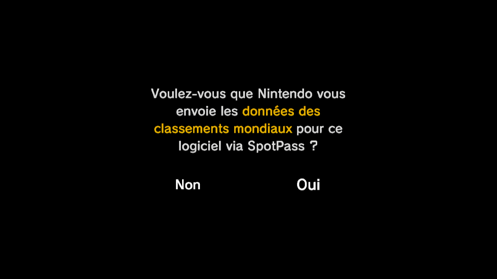
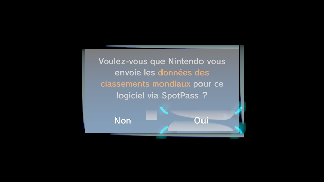
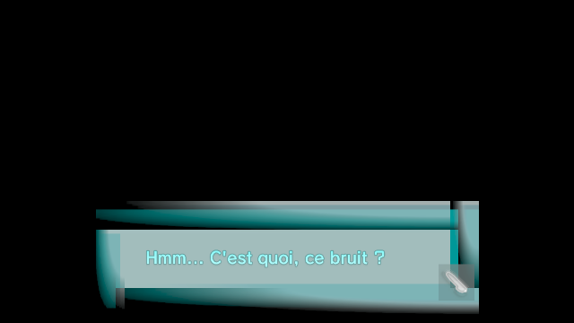
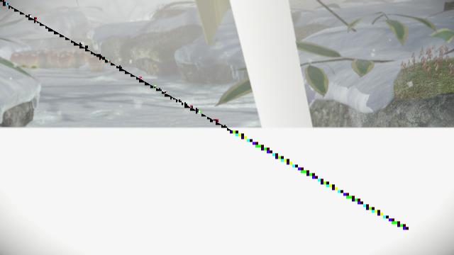
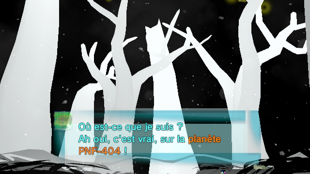
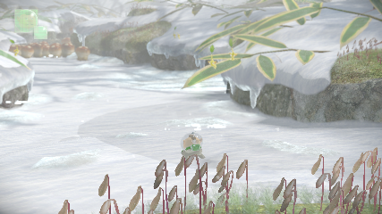
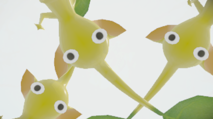
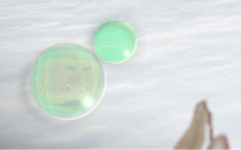

# recomp/ - Recompilateur Pikmin 3 (plan d'adaptation)

> Surface HLE : `../extracted/rpl_imports.txt`.

## Décision d'architecture : **adapter XenonRecomp**

On n'écrit pas un recompilateur PPC→C depuis zéro et on ne part pas de N64Recomp (MIPS).
On adapte **XenonRecomp** (`../tools/XenonRecomp`), seul recompilateur **statique PowerPC→C++**
existant et éprouvé (Xbox 360 / « Sonic Unleashed Recompiled »). Il est lui-même inspiré de
N64Recomp. Il ne fournit **pas** de runtime : il traduit le code, le reste est à notre charge.

### Pourquoi ça colle
- Modèle **32-bit + pointeur de base** : la Wii U est du PPC 32-bit pur (le 360 est 64-bit en
  mode 32) → encore plus simple.
- **Big-endian** géré par byteswap sur load/store : identique à notre besoin.
- **État CPU** passé à chaque fonction, émission C++ par fonction : réutilisable tel quel.
- Entrée via **config TOML** avec `[[functions]] address/size` : correspond exactement à ce
  que Ghidra nous a donné (voir `config/carrot_functions.toml`, déjà généré).

### Les écarts à combler (du plus structurant au moins)

1. **Jeu d'instructions - paired-singles (le gros morceau).**
   Le désasm de XenonRecomp (`thirdparty/disasm`, dérivé de GNU binutils) est calibré **Xenon** :
   il a le **VMX128** (que la Wii U n'a PAS) et **zéro** instruction **paired-singles** `ps_*/psq_*`
   (vérifié : 0 occurrence dans `ppc-inst.h`). L'Espresso (Gekko/Broadway) utilise les
   paired-singles (2×f32) pour tout le SIMD/FP.
   - (a) **Désassemblage** : porter les entrées Gekko PS depuis binutils amont (catégorie
     `PPC_OPCODE_PPCPS` / `-mgekko`/`-mbroadway`) dans `ppc-inst.h`/`ppc-dis.c`.
   - (b) **Codegen** : ajouter l'émission C++ des `ps_*`/`psq_l/psq_st` dans `recompiler.cpp`
     (là où XenonRecomp gère le VMX). Le VMX128 du 360 peut être **retiré/ignoré** (inutile ici).
2. **Loader d'image - RPL/ELF au lieu de XEX.**
   XenonRecomp lit du XEX (voir `XenonUtils/xbox`, + tiny-AES/libmspack pour déchiffrer/décompresser).
   Nous, on a déjà l'**ELF décompressé** (`../extracted/carrot.elf`). Écrire un
   petit loader qui mappe nos sections (`.text` @0x02000000, `.rodata/.data` @0x10000000, `.bss`)
   dans le modèle mémoire de XenonRecomp. Pas de .pdata (spécifique PE/360) → on fournit les
   bornes de fonctions par le TOML (ci-dessous).
3. **Découverte de fonctions - faite via Ghidra.**
   XenonAnalyse détecte les fonctions via `.pdata` (360) : inapplicable. Mais on a **45 197
   fonctions** exportées de Ghidra → `config/carrot_functions.toml` (format `[[functions]]`
   natif XenonRecomp). Les **jump tables** (`[[switch]]` dans le TOML) restent à extraire
   (Ghidra les connaît : à exporter via un script similaire).
4. **Runtime / HLE Cafe OS - le plus gros chantier (séparé du recompilateur).**
   Implémenter les **19 bibliothèques / 492 fonctions** de `../extracted/rpl_imports.txt`
   (coreinit, gx2, snd_core, vpad, padscore, nn_*…). **Référence** : `../tools/decaf-emu`
   (`src/libdecaf/src/cafe/libraries/` couvre nos 19 libs, y compris `nn_acp`). Postes majeurs :
   - `coreinit` (threads, MEM heaps, FS, OSTime…) - 146 fonctions.
   - `gx2` → traduire vers **Vulkan** (dispo sur l'hôte) ; shaders **GX2/GFD `Gfx2`** → SPIR-V. 116 fonctions.
   - `snd_core` (AX) → backend audio. 57 fonctions.
   - input `vpad`/`padscore`, `proc_ui`, `sysapp`, `nn_save`/`nn_act`/…

## Build de XenonRecomp (prérequis)

✅ **Déjà construit et validé (2026-10-21)** - binaires dans `../tools/XenonRecomp/build-clang/` :
`XenonRecomp/XenonRecomp` et `XenonAnalyse/XenonAnalyse`.
```bash
cd ../tools/XenonRecomp
git submodule update --init --recursive     # remplit thirdparty/ (fait)
# ⚠️ GCC 16 ÉCHOUE (membres be<T> dans structs anonymes de xbox.h/xdbf.h) → compiler avec CLANG :
cmake -S . -B build-clang -G Ninja -DCMAKE_BUILD_TYPE=Release \
      -DCMAKE_C_COMPILER=clang -DCMAKE_CXX_COMPILER=clang++
cmake --build build-clang
```
Usage des binaires :
- `XenonRecomp <config.toml> <ppc_context.h>` → génère le C++ (le 2e arg = en-tête de contexte
  PPC, template fourni dans le repo ; définit le struct d'état CPU).
- `XenonAnalyse <image.xex> <jumptable.toml>` → **spécifique XEX 360**, inutilisable tel quel
  sur notre RPL : on obtiendra fonctions **et** jump tables depuis Ghidra.

## Schéma TOML de config (ce que XenonRecomp consomme)

Champs clés (source : `../tools/XenonRecomp/XenonRecomp/recompiler_config.cpp`) :
`file_path` (image), `out_directory_path`, `switch_table_file_path`, `[[functions]]`
(`address`,`size`), `[[switch]]` (jump tables), `[[midasm_hook]]`, `invalid_instructions`,
flags d'optimisation (`skip_lr`, `*_as_local`…). Notre `config/carrot_functions.toml` remplit
déjà la partie `[[functions]]`.

## Patches appliqués au fork (2026-10-21)

Notre adaptation de XenonRecomp (édité en place dans `../tools/XenonRecomp`, à formaliser
en fork git) :

1. **`XenonUtils/image.cpp` - `ElfLoadImage`** : les RPL/RPX Wii U n'ont **pas de program
   headers** (`e_phnum == 0`). Ajout : si aucun `PT_LOAD`, la **base** est déduite de la plus
   basse section *allouée* (→ `0x02000000`, `.text`). Et on ne mappe **que** les sections
   `SHF_ALLOC` (on ignore `.rela*`, `.symtab/.strtab`, CRCs/fileinfo).
2. **`XenonRecomp/recompiler.cpp` - `Analyse()`** : le déréférencement inconditionnel de
   `.pdata` (spécifique XEX 360) **plantait** sur nos RPL (pas de `.pdata`). Encadré par un
   test de nullité ; les bornes de fonctions viennent du TOML (Ghidra).
3. **`XenonUtils/ppc_context.h`** : ajout de `ps1[32]` (2e élément paired-single de chaque FPR,
   ps0 = `fN` existant) et `gqr[8]` (registres de quantification pour `psq_l/st`), en fin de
   struct → additif, aucun offset existant décalé.
4. **`thirdparty/disasm/ppc-inst.h` + `XenonUtils/disasm.cpp`** : 29 ids `PPC_INST_PS_*` et un
   pré-passage `decodePairedSingle()` qui intercepte les opcodes primaires **4 / 56 / 60**
   (que binutils « cell 64 » mal-décoderait en VMX) et renvoie les paired-singles avec leurs
   opérandes. **Validé** par `../scripts/test_disasm.cpp` (ps_add, ps_merge10, psq_l).
5. **`XenonRecomp/recompiler.cpp` + `XenonUtils/ppc_context.h`** : codegen des 24 ops
   paired-single (arith `float` sur ps0/ps1, émission via temporaires pour l'aliasing),
   `psq_l/psq_st` branchés sur `PPCLoadPaired`/`PPCStorePaired` (dé-quantification GQR, types
   f32/u8/u16/s8/s16 + scale), et `mtspr/mfspr` qui alimentent/lisent `ctx.gqr[]`. Compile ;
   **validé** : `../scripts/make_tiny_ps_elf.py` génère un mini-ELF (6 instr. PS), XenonRecomp
   le recompile (EXIT 0) et le C++ produit **compile** (`clang++ -fsyntax-only`, RC=0).

> ⚠️ **Perf connue** : `Recompiler::Analyse()` scanne tout le `.text` (21 Mo) même si la config
> ne liste que quelques fonctions → recompiler l'image entière prend plusieurs minutes (~45k
> fichiers). Pour tester vite, utiliser un mini-ELF (`make_tiny_ps_elf.py`). Optimisation
> possible : restreindre l'analyse aux `config.functions`.

**Validation** : `ParseImage("carrot.elf")` renvoie base `0x02000000`, entry `0x03464778`,
toutes les sections mappées à leur VA (test autonome `../scripts/test_loader.cpp`). Le binaire
complet passe désormais le chargement sans crash et entre dans l'analyse.

> ⚠️ **Gotcha config** : `file_path` et `out_directory_path` sont résolus **relativement au
> dossier du fichier de config** (`recompiler.cpp` fait `directoryPath + filePath`). Mettre la
> config à côté du binaire (ou symlink). Un `file_path` introuvable → buffer vide → **segfault**
> dans `ParseImage` (durcissement possible, non bloquant).

## Paired-singles - spec d'implémentation (scopée le 2026-10-21)

Scan du `.text` (`../scripts/scan_paired_singles.py`, sortie complète dans
`../notes/paired_singles_scope.txt`) : **34 017** instructions paired-single sur 5,36 M
(**0,635 %**). Petit mais incontournable. **Seulement 24 opcodes distincts** → tâche bornée.

Jeu d'opcodes à implémenter (par fréquence) :
`ps_merge10` 11719, `psq_l` 9108, `psq_st` 5213, `ps_muls0` 2098, `ps_add` 1544,
`ps_sub` 1293, `ps_mul` 892, `ps_sum0` 643, `ps_madds0` 544, `ps_madds1` 503,
`ps_madd` 173, `ps_msub` 81, `ps_merge11` 49, `ps_merge00` 48, `ps_nmadd` 24,
`ps_sum1` 23, `ps_merge01` 19, `ps_mr` 17, `ps_nmsub` 13, `ps_sel` 4, `ps_neg` 3,
`ps_muls1` 2, `ps_rsqrte` 2, `ps_cmpo0` 2.
→ Mémoire : **uniquement `psq_l`/`psq_st`** (pas de formes `u` à update). 

Trois chantiers (dans l'ordre) :

1. **Contexte CPU** (`XenonUtils/ppc_context.h`) - fondation. `PPCRegister` ne stocke qu'un
   FP scalaire (`f64`), = **ps0**. Les paired-singles ont besoin d'un **ps1** par FPR. Ajouter
   32 slots `ps1` (ex. `double ps1` par FPR, ou un tableau) + les **8 registres GQR**
   (`spr` 912-919) pour la (dé)quantification de `psq_l/psq_st`. Les ops scalaires FP
   existantes ne touchent que ps0 → inchangées.
2. **Décodeur** - le désasm est initialisé en `"cell 64"` (VMX/AltiVec), qui **mal-décode**
   l'opcode 4 et 56/60 en VMX. Ne PAS compter sur binutils ici : ajouter un **pré-passage**
   dans le wrapper `XenonUtils/disasm.cpp` (ou `decode_insn_ppc`) qui, pour primaire ∈ {4,56,60},
   reconnaît les 24 opcodes ci-dessus (table XO) et renvoie un id `PPC_INST_PS_*` dédié
   (nouvelles entrées dans `thirdparty/disasm/ppc-inst.h`). Encodages : primaire 4 X-form
   (bits 1-10) et A-form (bits 1-5) ; `psq_l/st` = primaire 56/60 avec I (GQR#) bits 12-14,
   W bit 15, offset 12 bits signés.
3. **Codegen** (`XenonRecomp/recompiler.cpp`, le gros `switch`) - ajouter les cas
   `PPC_INST_PS_*` émettant du C++ sur ps0/ps1 (arith en **float**, pas double). Neutraliser
   le chemin VMX128 (inutile ici). `psq_l/st` : (dé)quantifier selon le type/échelle du GQR.
   Réfs d'implémentation exacte : manuel Gekko/Broadway, et `../tools/decaf-emu`
   (`src/libdecaf/src/cafe/libraries/gx2` + le cœur `espresso`/interpréteur de decaf pour la
   sémantique ps_* et GQR).

## État / prochaines tâches (ordre conseillé)

- [x] Décision d'architecture : adapter XenonRecomp.
- [x] Export des bornes de fonctions Ghidra → `config/carrot_functions.toml` (45 197 fns).
- [x] `git submodule update --init` + build de XenonRecomp (avec **clang**) → binaires OK dans `build-clang/`.
- [x] **Loader RPL/ELF minimal** - `carrot.elf` se charge dans XenonRecomp (voir « patches » ci-dessous). Validé.
- [x] **Scope paired-singles** mesuré : 24 opcodes, 34 017 instr. (0,635 %), psq_l/st seulement (voir section dédiée).
- [x] Paired-singles #1 : ps1[32] + gqr[8] ajoutés au `ppc_context.h`.
- [x] Paired-singles #2 : **décodeur** (pré-passage opcodes 4/56/60 → `PPC_INST_PS_*`) - validé (ps_add/ps_merge10/psq_l OK, opérandes correctes).
- [x] Paired-singles #3 : codegen (24 ops + `psq_l/st` via GQR + `mtspr/mfspr` GQR) - **validé de bout en bout** : un mini-ELF PS recompile et le C++ généré **compile** (RC=0).
- [x] Jump tables → `config/carrot_switch.toml` (101 tables, 2 568 cases ; détection maison, voir plus bas).
- [x] Recompilation de **l'image entière** : 112 435 fonctions, 444 fichiers C++ (~350 Mo), 28 s.
- [x] Runtime HLE de départ + **`pikmin3.exe`** (Windows, clang-cl) - voir « Build Windows » ci-dessous.
- [x] **Le jeu démarre et tourne dans sa boucle principale** (2026-10-22) : ~240 fichiers chargés
  (shaders, polices et messages en français, layouts, données de démo, config.sav…), une vingtaine
  de threads, ~58 images/s calées sur la vsync, de façon reproductible. Écran noir et silence.
- [ ] Rendu GX2 → Vulkan (shaders GX2/GFD → SPIR-V) - le gros chantier suivant.
- [ ] Entrées (clavier/manette → VPAD), audio AX (voix + sortie), vidéos h264.

## Session du 2026-10-21 (Windows) - passage à l'exécutable

Constats qui corrigent l'état ci-dessus :

- **~40 000 instructions étaient silencieusement omises.** XenonRecomp ne connaissait pas une
  trentaine d'instructions PowerPC 32 bits absentes du code 360 mais omniprésentes chez Green
  Hills : `lmw`/`stmw` (16 916 + 12 008, prologues/épilogues), `isync`, `crclr`/`crset`,
  `addc`, `addme`, `subfze`, `subfme`, `eqv`, `rlwnm`, `frsqrte`, `lswi`/`stswi`, les accès
  avec mise à jour (`lhzu`, `sthu`, `lfsu`, `stfsu`, `lfdu`, `stfdu`, `l*ux`, `st*ux`),
  `bnel`/`beql`, `tw`, `dcbst`. Toutes ajoutées au codegen (`recompiler.cpp`) : **0 instruction
  non reconnue** sur l'image entière.
- **Les appels Cafe OS n'avaient pas de cible.** Les ~12 000 `bl` vers les imports ne sont
  résolus que par relocation. `scripts/link_rpl.py` joue le rôle du loader : il reloge les
  sections d'import en `0x03500000` (à portée de `bl`), applique toutes les relocations (les
  internes ne changent rien : l'image est déjà liée à son adresse) et produit
  `carrot_linked.elf` + `config/imports.toml` + `runtime/generated/imports.inc`.
  Les symboles faibles `$UNDEF` restent à 0 (le crt0 teste leur adresse).
- **Bornes de fonctions** (`scripts/gen_recomp_config.py`) : départs Ghidra + cibles de `bl` +
  toutes les adresses de code référencées par relocation (vtables, pointeurs de fonction : +66 627
  petites fonctions virtuelles et thunks C++ que l'export Ghidra excluait), partition contiguë,
  puis fonctions **chevauchantes** pour les entrées en milieu de fonction (routines GHS de
  restauration de registres, code partagé) - 0 branchement non résolu.
- **Switch Green Hills** : pas de table d'adresses mais une « branch table » de `b case` juste
  après le `bctr` (`ctr = table + 4*i`). Le fork aiguille sur la valeur de CTR (`[[switch]]`
  sans `r`).
- Autres patches du fork : `[[import]]` (fichier `import_file_path`), cible sans symbole →
  `PPC_CALL_INDIRECT_FUNC` (échec bruyant au lieu d'un `// ERROR` silencieux), `PPC_TRAP` pour `tw`.

## Session du 2026-10-22 - jusqu'à la boucle principale

Le projet a été déplacé de `W:\pikmin` (disque externe USB qui s'est déconnecté) vers
`C:\Users\youne\delivery\pikmin` ; copie vérifiée par SHA-256 (16 917 fichiers identiques).
⚠️ `PIKMIN 3 [Game]/content/CMCmn/shader/lyt_BuildinShader.gsh` est un **dump hexadécimal texte de
`font_BuildinShader.gsh`** (écrasé le 20/10, avant cette reprise) : l'original est perdu dans cette
copie, à récupérer depuis le jeu d'origine pour le rendu de l'interface.

Corrections qui ont fait passer du crt0 à la boucle principale :

- **Routines GHS de sauvegarde de registres** (`stw r14..r31 ; mflr r31 ; blr`, une entrée par
  registre, chacune cible de `bl`) : la partition en faisait des fonctions de 4 octets qui
  « retournaient » au lieu de continuer → registres non sauvegardés, `r31` corrompu, boucle infinie
  sur les constructeurs statiques. `gen_recomp_config.py` prolonge toute fonction qui tombe dans la
  suivante jusqu'à son terminateur (avant la découverte des entrées chevauchantes), et
  `Recompiler::Analyse()` avance de début de fonction en début de fonction (sinon il boucle).
- **`lwarx` non volatile** : XenonRecomp lisait la réservation avec un simple `*(uint32_t*)`, que
  clang sort des boucles d'attente `lwarx ; cmpwi ; bne` → verrous tournants infinis selon le
  timing (blocage aléatoire du gestionnaire de tâches multi-cœurs de sead). Lecture volatile.
- **AX** (`runtime/snd.cpp`) : un « AX Callback Thread » appelle toutes les 3 ms les callbacks de
  trame de l'application et de mixage final (tampons silencieux). nw::snd vide sa file de
  commandes dans ces callbacks ; sans eux, la file se remplit et bloque les threads qui jouent un son.
- **Région/langue** : `MCP_GetSysProdSettings` remplit `product_area`/`game_region` en u32
  (Europe) → le jeu charge `EUFre` au lieu de `JPJpn`. Répertoire FS courant initial = `/`.
- **OSDynLoad** : les exports des bibliothèques chargées dynamiquement (ex. `erreula`) reçoivent
  un stub qui renvoie 0, ou un `HLE_FUNC(erreula, …)` s'il existe.

Outils de diagnostic de `pikmin3.exe` :

- `--dump <s>` : après *s* secondes, état de chaque thread (bloqué sur quelle primitive, appelée
  d'où ; registres et objets pour les threads actifs), puis à nouveau 3 s plus tard.
- `--record <filtre>` : enregistre en mémoire les appels HLE dont le nom contient *filtre*
  (`*` = tous), vidés par `--dump`. Sans effet notable sur le timing, contrairement à
  `--trace` / `--trace-filter <filtre>` qui écrivent chaque appel dans `pikmin3.log`.

## Session du 2026-10-22 (suite) - rendu : GX2 + libgpu de decaf

⚠️ **Licence** : le rendu réutilise du code de decaf-emu (GPL-3.0). `pikmin3.exe` qui l'intègre
relève donc de la GPL-3.0 s'il est un jour distribué (sans incidence pour un usage personnel).

Architecture (voir `gpu/`) :
- `gpu/CMakeLists.txt` compile, depuis `tools/decaf-emu`, **libgpu** (paquets PM4 → Vulkan,
  traducteur de shaders Latte → SPIR-V, détuilage addrlib), **common**, **libgfd** et **les
  40 sources GX2 de decaf telles quelles** (C++17 ; en-têtes Vulkan 1.3.268 de
  `tools/Vulkan-Headers-1.3.268`, le `vulkan.hpp` du SDK 1.4 n'étant plus compatible).
- `gpu/cpu_shim.cpp` remplace libcpu pour libgpu : bases d'adresses = notre mémoire invitée
  (physique = virtuel), détection des écritures CPU par hachage.
- `gpu/bridge/decaf_bridge.cpp` : branche les 115 fonctions GX2 de decaf sur les imports
  `gx2::*` (conversion `PPCContext` ↔ `cpu::Core`, enveloppes typées de decaf réutilisées),
  alloue ses données internes en mémoire invitée, implémente `cpu::this_core::executeSub()`
  pour les rappels vers le jeu, et appelle `rpl_entry` de gx2.rpl au démarrage.
- `gpu/bridge/decaf_compat_*.cpp` : les 36 symboles externes que la GX2 de decaf référence -
  coreinit (redirigé vers notre runtime via `hleInvoke`), **TCL** (soumission au ring,
  timestamps EOP, thread « GPU7 Interrupts ») et l'infrastructure HLE (trace, config…).
- `gpu/bridge/gpu_window.cpp` : fenêtre Win32 + pilote Vulkan sur son thread ; le thread
  principal pompe les messages. `--capture` enregistre la fenêtre (BMP) toutes les 500 ms.

État : le pilote Vulkan affiche les écrans TV et GamePad (disposition de decaf : fond rouge,
TV en haut, GamePad en bas) ; le jeu soumet ses commandes GPU, charge shaders et polices, puis
**s'arrête dans `GX2SetVertexShader` (shader sans programme) juste après avoir chargé
`CMCmn/shader/lyt_BuildinShader.gsh`** - le fichier abîmé du dump (voir plus haut). Il faut
l'original : le copier dans le dump ou dans `recomp/content_override/CMCmn/shader/`
(dossier de surcharge lu en priorité par le FS).

Correctifs associés : `MEMGetBaseHeapHandle(8)` = tas du foreground bucket (MEMBaseHeapType
FG = 8, pas 2) ; patch decaf `gx2_fetchshader.cpp` : `DST_GPR(location & 0x7F)` (un attribut
absent du shader a `location = -1`, le matériel masque, decaf assertait) ; `OSSleepThread` /
`OSWakeupThread` ajoutés au noyau (attente bornée à 20 ms) ; implémentations HLE avec
contexte (`hleSetImplementation`, `exportHostFunction(fn, user)`).

## Premier écran du jeu (2026-10-22)



Le jeu va maintenant **jusqu'à sa première question** - « Voulez-vous que Nintendo vous envoie les
données des classements mondiaux … via SpotPass ? - Non / Oui » - en français, police et
animation d'apparition du texte comprises.

Ce qui a débloqué la suite après `lyt_BuildinShader.gsh` abîmé (garde-fous dans
`gpu/bridge/decaf_bridge.cpp`, devant les appels GX2) :
- `GX2Set{Vertex,Pixel,Geometry}Shader` d'un shader **sans programme** : signalé, ignoré ; les
  dessins (`GX2Draw*`) sont ignorés tant que le jeu croit un shader vide lié.
- Emplacements invalides (−1) tirés du shader vide : `GX2Set*Sampler`, `*Texture`,
  `*SamplerBorderColor` (≥ 0x12), `*UniformBlock` (≥ 16), `GX2Set{Vertex,Pixel}UniformReg`
  (décalage hors des 256 vecteurs de l'étage) : ignorés, une alerte par fonction.
- `cpu::this_core::id()` renvoie le **vrai cœur** du thread (GX2 tient un tampon de commandes
  par cœur ; avec « toujours cœur 1 », deux listes d'affichage s'écrasaient).
- Tous les imports GX2 du jeu sont couverts par decaf, sauf `GX2SetDebugMode` (sans effet).

**Corrigé - image tournée de 180° (ps1 des opérations scalaires).** L'image sortait retournée
haut/bas **et** gauche/droite. Les sondes (`--probe`, `runtime/probe.cpp`) ont montré que
`MTX44Concat` (0x03463540) calcule un produit exact, et que les sources (viewport, copie vers
l'écran, arguments GX2) étaient bonnes ; la matrice modèle-vue envoyée au GPU valait déjà
`-1.1 0 0 -155 | 0 -1.1 0 115 | 0 0 1 -989` : une rotation de 180° autour de Z, calculée côté CPU
(axes X et Y de la caméra inversés). Cause, trouvée en comparant la sémantique du recompilateur à
l'interpréteur de decaf : sur l'Espresso, **les opérations scalaires simple précision écrivent
leur résultat dans ps0 *et* ps1** (`lfs`/`lfsu`/`lfsx`/`lfsux`, `fadds`, `fsubs`, `fmuls`,
`fdivs`, `fmadds`, `fmsubs`, `fnmadds`, `fnmsubs`, `fres`, `frsp`). XenonRecomp, écrit pour la
Xbox 360, n'écrivait que ps0 : le jeu lisait ensuite un ps1 périmé (`ps_merge10`, `ps_sum0`,
`ps_mul`…). Correctif dans `XenonRecomp/recompiler.cpp` (`splatPs1`), code régénéré : image à
l'endroit sans contournement (l'option `--rotate180` a été retirée).

Autres observations : sur mes captures (`--capture`, `PrintWindow`), environ 1 image sur 3 est
noire, alors que le jeu envoie bien une copie vers l'écran TV par image (`--record ScanBuffer` :
1232 copies TV+GamePad pour 615 échanges). Très probablement un artefact de capture, **à
confirmer à l'œil** (clignotement ou non). Les options `--split` (TV + GamePad) et `--capture`
(BMP dans `capture/`) aident à diagnostiquer.

## lyt_BuildinShader.gsh reconstruit (2026-10-22)



Le shader d'interface manquant est remplacé par des shaders écrits à la main en assembleur
Latte (`shaders/lyt/`, voir son README) : les fenêtres, boutons et cadres de sélection
s'affichent. Rendu approché (un seul mode de mélange de textures). Deux bugs de
l'assembleur de decaf corrigés au passage (métadonnées jamais lues, masque de sortie).

## Après le dialogue SpotPass : première 3D (2026-10-22)

Une fois la question SpotPass répondue (la réponse est enregistrée, elle ne revient plus), le
jeu lance la cinématique `CMCmn/movie/openingMovie.mp4`. Le décodeur H.264 n'est pas émulé :
`runtime/h264.cpp` refuse `H264DECMemoryRequirement`, le lecteur abandonne la vidéo et le jeu
enchaîne sur la carte `mapC`. Deux instructions de shader manquaient au traducteur
Latte → SPIR-V de decaf (dans `patches/decaf-emu.patch`) :
- `GET_COMP_TEX_LOD` (niveau de détail calculé) → `OpImageQueryLod` ;
- `LOOP_BREAK` (sortie de boucle) → variable de sortie par boucle, conservée après les dépilements.

Le décor 3D s'affiche (`docs/premiere_3d.png`), puis la première bulle de l'histoire
(`docs/bulle_intro.png`). Défauts encore visibles : moitié basse blanche, une ligne diagonale.

**Orientation verticale** : decaf retourne le viewport Vulkan (« flipped by default ») ; c'est la
bonne convention pour ce jeu (la police du jeu place le haut des glyphes vers y = -1). Un essai
de garder l'autre convention (viewport non retourné, image retournée à l'affichage, sens des
faces inversé) reste disponible avec `DECAF_GPU7_ORIENTATION=1` mais met le texte à l'envers.
**Textures rendues par le GPU dans l'interface** : la bulle de l'intro et la lueur des titres
passent par une image rendue par le GPU puis affichée dans un pane lyt. Ces images ont l'axe V
inversé par rapport aux textures des fichiers ; le vrai `lyt_BuildinShader` en tenait compte.
Le pont note la mémoire des cibles de couleur (`GX2SetColorBuffer`) et, après chaque
`GX2SetPixelTexture` sur l'emplacement 0, écrit dans le registre C255 la transformation de V
(`(1, -1)` pour une cible de rendu, `(0, 1)` sinon) que `lyt.psh` applique avant d'échantillonner.
La sonde `--probe` journalise chaque `GX2SetViewport` distinct.





## Intro de l'histoire : corrections du rendu 3D (2026-10-22)

- **GQR non initialisés** (`runtime/kernel.cpp`) : Cafe OS met GQR2-5 à u8, u16, s8, s16 à la
  création de chaque thread ; nos contextes les laissaient à 0 (flottant), donc toute donnée
  quantifiée lue par `psq_l` (animations, positions…) devenait n'importe quoi : grands polygones
  étirés sur tout l'écran.
- **Mémoire réutilisée après un rendu GPU** (`patches/decaf-emu.patch`, `vulkan_memtracker.h`) :
  decaf cessait de surveiller les écritures CPU sur une zone écrite par le GPU (cible de rendu).
  Quand le jeu libère cette mémoire et y charge une texture, decaf gardait l'ancien contenu
  (aplats, pixels parasites). On garde maintenant l'empreinte de la mémoire au moment de
  l'écriture GPU : si elle change ensuite, c'est le CPU et ses données l'emportent.
- **Profondeur D24S8 sur cartes AMD** (`vulkan_utils.cpp`, `vulkan_validate.cpp`) : le format
  de profondeur du jeu (24 bits + stencil) n'est pas utilisable comme cible de profondeur sur
  ces cartes ; decaf le créait quand même et les objets se recouvraient dans le désordre. Repli
  automatique sur D32S8 quand le pilote ne le prend pas en charge.
- **Journal de decaf** : avec `--probe`, les messages internes de libgpu (formats non pris en
  charge, draws ignorés…) s'affichent sur la console.
- **`--auto-a <ms>`** : appuie sur A toutes les `<ms>` ms, pour faire défiler les dialogues
  sans joueur (captures automatiques avec `--capture`).



### Analyse RenderDoc : sondes, culling, rétroaction (2026-10-22)

RenderDoc 1.46 (portable, `decompile/tools/renderdoc_dl/`, non versionné) a permis de suivre une
image complète. `--rdoc-capture <s>` capture l'image suivante après `<s>` secondes (lancer avec
`ENABLE_VULKAN_RENDERDOC_CAPTURE=1 VK_LAYER_PATH=<dossier RenderDoc>
VK_INSTANCE_LAYERS=VK_LAYER_RENDERDOC_Capture`) ; `DECAF_RDOC_ON_CUBE=1` capture 1,5 s dès que le
jeu dessine dans une cube map. Trois bugs de decaf trouvés (`patches/decaf-emu.patch`) :
- **Culling** : avec le viewport non retourné (essai d'orientation, désormais optionnel), le sens
  des triangles vu par Vulkan s'inversait et decaf éliminait les faces avant ; les sondes de
  lumière (cube maps 48×48, un triangle plein écran) n'étaient jamais calculées. Le sens des faces
  suit maintenant l'orientation choisie (`vulkan_pipelines.cpp`).
- **Copie d'image invalide** (`_copySurface`) : profondeur de copie = nombre de couches pour des
  tableaux 2D (Vulkan exige 1) ; la copie était ignorée.
- **Rétroaction** : un passage plein écran lit l'image qu'il écrit (accepté par GPU7, indéfini
  en Vulkan : blocs de pixels parasites sur cartes AMD). `resolveTextureFeedback` copie la cible
  avant le dessin et fait lire la copie.





### Performances (2026-10-23)

Mesure : le jeu journalise ses images/s toutes les 5 s ; `--profile <s>` échantillonne tous
les threads (piles d'appels résolues avec le .pdb) pendant `<s>` secondes après 60 s de jeu.
Constat : le thread de rendu du jeu attend surtout le GPU (`GX2DrawDone`), et le thread GPU de
decaf passait son temps à :
- **allouer de la mémoire Vulkan** : decaf crée un tampon par couple (adresse, taille) de
  données (sommets, uniformes qui bougent à chaque image) et ne le libérait jamais ; VMA en
  faisait des allocations dédiées, lentes. Les tampons de données inutilisés depuis 300 lots
  sont maintenant libérés (`evictMemCaches`) et tous viennent d'un pool VMA à gros blocs ;
- **hacher la mémoire invitée** pour détecter les écritures du CPU : la mémoire invitée est
  réservée avec `MEM_WRITE_WATCH` et `gpu/cpu_shim.cpp` demande au système les pages écrites
  pour les grandes plages (empreinte des données pour les petites).

Résultat : environ 20 images/s en jeu (10 à 17, avec des chutes à 3, auparavant).

### HUD : combineur de textures de nw::lyt (2026-10-23)

Les bulles du HUD (visage du capitaine, bulle de vie à rayures) s'affichaient en carrés gris
quadrillés. Le shader lyt de remplacement ne lisait que la texture 0 ; il combine maintenant
jusqu'à 3 textures selon `uTextureMode` (Modulate, Add, Overlay…, et l'indirection qui décale
les coordonnées : réfraction du décor dans les bulles), génère les coordonnées projetées
(`uGeneratingTexCoord`) et tient compte du choix du programme par le jeu : un matériau à une
texture n'envoie pas toujours `uTextureMode`. Détails : `shaders/lyt/README.md`.
`DECAF_RDOC_EVERY=<s>` (avec `--rdoc-capture`) enchaîne 8 captures RenderDoc espacées de `<s>` s.



### Problèmes ouverts (retour de test du 2026-10-23)

Relevés sur les captures en jeu (intro, zone enneigée, appel du communicateur) :
1. **Modèle de Charlie / des Pikmin déformé** (« on dirait un singe ») : pas reproduit sur mes
   captures (Charlie couché au début = animation de réveil de l'intro). Pistes : skinning GPU
   (`spirv_vtx.cpp`), formats de sommets compressés, morphing du visage.
2. ~~Visage du HUD trop transparent~~ (voir 5) et ~~à l'envers~~ : corrigés : corrigé (V retourné pour toutes les textures nw::lyt) ; les
   portraits du communicateur (hexagones, au lieu de « X ») aussi.
3. ~~Boîtes de dialogue mal construites~~ : corrigé (coordonnées de cadre `uFrameSpec` bornées
   par pixel pour tous les programmes, Replace de l'étage 0 = capture du fond ;
   `shaders/lyt/README.md`). Reste : texte du premier dialogue gris clair au lieu de cyan.
4. ~~Artefacts en bas de l'écran et écrans blancs~~ : corrigés (2026-10-24). decaf ne posait pas
   de barrière entre deux écritures de transfert successives sur la même image ou la même
   mémoire (rechargement depuis la mémoire puis effacement, deux copies…) : le GPU pouvait les
   réordonner, et des valeurs périmées revenaient selon le minutage (d'où l'absence de défaut
   dans les rejeux RenderDoc). La cible de visibilité du soleil accumulait ainsi des valeurs
   absurdes (disque blanc géant, exposition faussée), et les tampons demi-résolution gardaient
   des blocs aux lignes 352-367. Barrière désormais posée (`_barrierSurface`, `_barrierMemCache`).
5. ~~Texte qui clignote~~ : corrigé (2026-10-24). Les programmes lyt 15 à 29 (variante 1,
   0x034614F0) servent aux panes blancs et opaques : le jeu n'envoie alors pas `uColor`
   (0x0346151C). Notre shader reconstruit la lisait quand même et prenait la valeur laissée par
   le dessin précédent : quand l'opacité de la boîte alternait 240/255 d'une image à l'autre,
   les lettres passaient de 240 à 20 (opacité des lignes dessinées juste avant). La variante 1
   a désormais une couleur de sommet à 1. Même cause pour le visage du HUD trop transparent.
   Sondes : `DECAF_PROBE_LYT_COLOR`, `DECAF_PROBE_PANE_ALPHA=<s>` (`runtime/probe.cpp`).
6. **Écran tactile sans effet** (« Toucher : bouger curseur ») : le toucher de la manette
   (VPADRead, `tpData`) n'est pas encore relié à la souris.
7. **Image délavée** et bandes cinéma grises : probablement liée à l'exposition faussée (4).
8. **Lenteur** : environ 28 à 30 images/s en jeu désormais (le jeu vise 30).

Outils ajoutés : `DECAF_RDOC_FRAMES=<n>` (avec `--rdoc-capture`) capture n images consécutives ;
`DECAF_SKIP_PS=<nom du dump>` et `DECAF_SKIP_TEXSIZE=<l>x<h>` sautent des dessins ; `--probe`
journalise aussi les couleurs de `GX2ClearColor`.

### Shaders du décor (en cours)

Arbres blancs et unis, sol noir. Diagnostic (outils ci-dessous) : les textures sont bonnes
(écorce, cartes de normales), c'est le **brouillard** qui sature : le shader de pixels finit par
`mix(éclairage, R0.rgb, R0.w)` et `R0.w` vaut ~1 sur les arbres. Le facteur vient du shader de
sommets : `clamp((dot(position, CB2[3].xyz) - CB2[3].w) * CB2[4].x)`, bloc uniforme 2. Cause pas
encore trouvée (paramètres du bloc 2 côté CPU, ou position d'entrée). Corrections déjà faites au
traducteur de decaf en chemin (conformes à la spécification GPU7) :
- `MUL`, `MULADD`, `DOT4` non-IEEE : un produit par 0 vaut 0 même avec inf/NaN ;
- `EXP_IEEE`/`LOG_IEEE` en base 2 (decaf utilisait exp/ln) ; `LOG_CLAMPED` borne -inf ;
- `GET_COMP_TEX_LOD` sur cube map : 2 coordonnées (SPIR-V invalide auparavant).

Outils de diagnostic (variables d'environnement) :
- `DECAF_DUMP_SHADERS=1` : shaders du jeu désassemblés + SPIR-V dans `recomp/dump/` (non versionné) ;
- `DECAF_DEBUG_FIRST_TEX=N` : les shaders de matériau (3 entrées ou plus) affichent leur N-ième texture ;
- `DECAF_DEBUG_INPUT0=C` : ils affichent la composante C (0-3) de leur première entrée, en gris.

## Affichage TV seul et commandes (2026-10-22)

- **Affichage** : `gpu_window.cpp` règle libgpu en `ViewMode::TV`, fond noir, ratio conservé (au
  lieu de la disposition TV + GamePad sur fond rouge de decaf). Vérifié par `--capture`.
- **Commandes** (`runtime/input.cpp`, lues par `VPADRead` dans `system.cpp`) : clavier **par
  position physique** (WASD = ZQSD sur AZERTY ; actif seulement fenêtre au premier plan) et
  manette XInput (la première connectée), combinables.

  | GamePad | Clavier (positions QWERTY) | Manette Xbox |
  |---|---|---|
  | Stick gauche / droit | W A S D / I J K L | sticks |
  | Croix | flèches | croix |
  | A / B | Espace / Maj gauche | B / A (placement Nintendo) |
  | X / Y | E / Q | Y / X |
  | L / R | 1 / 3 | LB / RB |
  | ZL / ZR | Ctrl gauche / C | gâchettes |
  | + / − / HOME | Entrée / Retour arrière / Origine | Start / Back / - |
  | Clic stick G / D | F / O | clic des sticks |

- `pikmin3.exe --input-test` ouvre la fenêtre sans lancer le jeu et journalise chaque changement de
  boutons/sticks (console et `pikmin3.log`) : pratique pour vérifier le mapping.
- Pas encore géré : écran tactile (toujours « pas de contact »), gyroscope/accéléromètre, Wiimotes
  (KPAD renvoie « pas de manette »), souris, remapping configurable.
- Vérifié avec `--input-test` (clavier) : **flèches** (croix), **Entrée** (+),
  **stick gauche** (4 directions + diagonale normalisée à 0,71 ; Y positif = haut, comme sur la
  console) et **ZL/ZR** (Ctrl gauche / C, y compris les deux ensemble).
  Reste à confirmer : stick droit (IJKL), A/B/X/Y/L/R, clics de sticks (F/O), − et HOME, et la
  manette XInput (aucune n'était branchée). Le journal affiche aussi les mouvements de sticks
  (écart ≥ 0,25 ou retour à zéro).
- Non vérifié dans le jeu : il plante avant son premier `VPADRead` (voir plus haut).

## Build Windows

Prérequis : VS 2022 (MSVC + SDK), LLVM/clang-cl, CMake, Ninja, Python 3 (+ `capstone` pour les
scripts d'inspection seulement).

Les outils tiers (`tools/`) ne sont pas dans le dépôt : les cloner et appliquer les correctifs de
`patches/` (voir `patches/README.md`). Les fichiers du jeu non plus : il faut son propre dump.

```bat
:: 1. XenonRecomp (fork)
cd tools\XenonRecomp
cmake -S . -B build-win -G Ninja -DCMAKE_BUILD_TYPE=Release -DCMAKE_C_COMPILER=clang-cl -DCMAKE_CXX_COMPILER=clang-cl
cmake --build build-win --target XenonRecomp
:: 2. Image liée + config + C++ généré
cd ..\..
python scripts\link_rpl.py extracted\carrot.elf recomp\carrot_linked.elf recomp\config\imports.toml recomp\runtime\generated\imports.inc
python scripts\gen_recomp_config.py extracted\carrot.elf recomp\carrot_linked.elf recomp\config\carrot_functions.toml recomp\config
tools\XenonRecomp\build-win\XenonRecomp\XenonRecomp.exe recomp\config\carrot.toml recomp\runtime\ppc_context.h
:: 3. Exécutable (vcvars64 + clang-cl + Ninja, configure au premier appel)
recomp\build.bat
recomp\build\pikmin3.exe            :: options : --split --capture --input-test --auto-a <ms> --dump <s> --record <filtre> --trace --root <dossier des données>
```

Le runtime (`runtime/`) : mémoire invitée 4 Gio (`memory.cpp`), table des fonctions et appels
indirects (`cpu.cpp`), dispatch des 493 imports (`hle.cpp`, macro `HLE_FUNC(lib, symbole)`),
threads Cafe OS sur threads hôtes + mutex/conditions/événements/files/alarmes (`kernel.cpp`),
tas MEM* (`coreinit_mem.cpp`), FS/SAVE avec overlay update > base (`coreinit_fs.cpp`), GX2 sans
rendu (`gx2.cpp`), cadence AX sans son (`snd.cpp`), proc_ui/vpad/nn_act minimaux
(`system.cpp`). Un import non implémenté renvoie 0 et est signalé une fois dans `pikmin3.log`.
